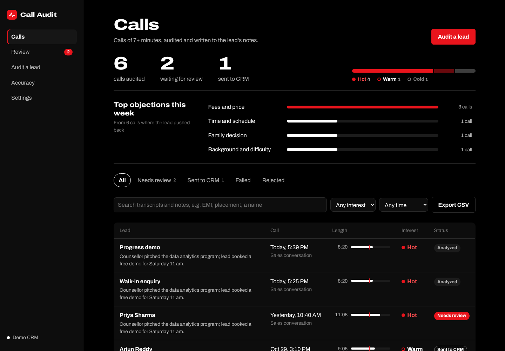
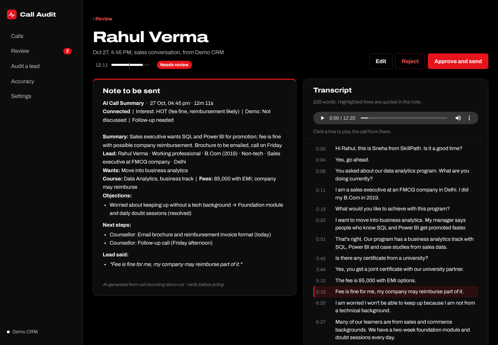
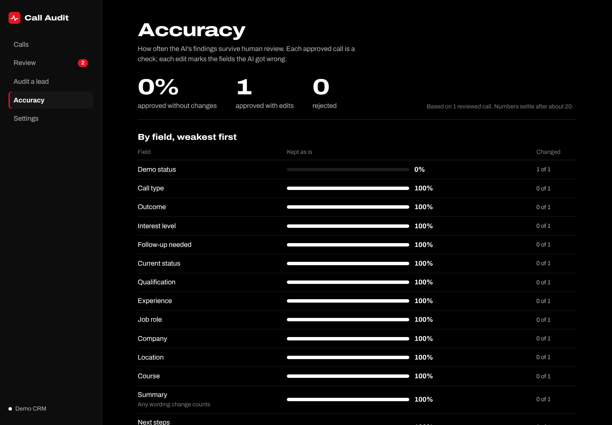

# AI Call Audit & CRM Automation

Pulls sales call recordings from a CRM, transcribes them with Whisper, analyzes
them with a local LLM (Qwen3 via MLX), and writes a structured note back to the
lead, so counsellors don't fill in post-call forms by hand. A web app lets a team
connect their CRM, review notes before they're sent, and track AI accuracy.

Works with **LeadSquared** today, plus a **Demo CRM** with sample calls so you can
try it without an account. Other CRMs plug into the same interface (`src/crm/`).



| Review a note against the transcript and recording | Accuracy measured from human review |
|---|---|
|  |  |

```
CRM call activity ─► download ─► clean audio ─► Whisper ─► Qwen3 ─► validate ─► review ─► lead fields + note
                     (each step saved in SQLite: stoppable, resumable, never sent twice)
```

**Highlights**

- Runs fully on a Mac (Whisper large-v3-turbo + Qwen3 via MLX): call audio never leaves the machine
- CRM connector layer: LeadSquared today, Demo CRM for trying it out, one file per new CRM
- Hallucination checks: quotes must appear word for word in the transcript; business
  rules override the model and every override is logged
- Human review with per-field accuracy tracking, so you know which AI fields to trust
- Structured notes: lead profile, intent, course and fees, objections with the
  counsellor's answer, next steps, verbatim quotes
- Only calls of 7+ minutes are audited (configurable): short calls rarely show intent
- Web app: calls list with search/filters/CSV export, synced audio player, upload a
  recording, live progress with stop/resume, top objections, settings with field mapping
- 53 tests: units, API end to end, a fake LeadSquared, stop/resume and progress

## Try it without a CRM

The Demo CRM has four sample leads with call transcripts, so no account is needed.
The AI step needs an Apple Silicon Mac.

```bash
npm install
python3 -m venv whisper-env && ./whisper-env/bin/pip install mlx-whisper mlx-lm
npm run web:build && npm run app      # http://127.0.0.1:5050
```

Open **Audit a lead**, pick a sample lead and run it. Turn on review in **Settings**
to approve notes before they're "sent".

## Setup

```bash
npm install
cp .env.example .env          # fill in LeadSquared keys

python3 -m venv whisper-env
./whisper-env/bin/pip install mlx-whisper openai-whisper mlx-lm
brew install ffmpeg            # audio cleanup + decoding
```

## Web app

```bash
npm run web:build     # once, and after pulling UI changes
npm run app           # open http://127.0.0.1:5050
```

- **Calls**: every audited call with its length against the minimum, interest and
  status; search transcripts and notes, filter by interest and period, export to CSV
- **Review**: check the AI note against the transcript (click a line to play the
  recording from there), edit, approve or reject
- **Audit a lead**: run the pipeline on a lead and watch its progress, or
  **upload a recording** (mp3/wav/m4a/ogg) to audit a call that isn't in a CRM;
  optionally link it to a CRM lead to send the note there
- **Accuracy**: how often each AI field survives review, plus pipeline checks
- **Settings**: pick the CRM, add API keys, test the connection, set review mode,
  minimum call length and which AI findings update which lead fields

The server listens on this machine only (no login yet, and Settings holds CRM keys).
For UI development: `npm run app` in one terminal, `npm run web:dev` in another.

## CLI

```bash
npm run process -- <leadId>          # audit the lead's newest call of 7+ min (MIN_CALL_MINUTES)
npm run process -- <leadId> --min-minutes 3   # one-off lower threshold
npm run process -- <leadId> --force  # redo it even if already synced
npm run status                       # recent calls and their state
npm run status -- --failed
npm run show -- <activityId>         # transcript, analysis, rule corrections
npm run retry -- <activityId>        # resume a failed call
npm run compare -- <activityId|mp3>  # old vs new transcription side by side
npm test
```

Helpers for configuring field mappings:

```bash
npm run lsq:fields -- experience     # find LeadSquared schema names
npm run lsq:activities               # list activity types / event codes
```

## How it works

| Path | Role |
|---|---|
| `src/cli.js` | Commands |
| `src/server/` | Express API + one-at-a-time job queue for the web app |
| `web/` | React + Vite frontend |
| `src/crm/` | CRM adapters (LeadSquared, Demo) behind one interface |
| `src/settings.js` | Settings saved from the UI (`.env` values are defaults) |
| `src/review.js`, `src/accuracy.js` | Approve/edit/reject flow and per-field accuracy |
| `src/pipeline.js` | Runs a call through the stages, resuming from the last completed one |
| `src/stages/` | `discover` → `download` → `preprocess` → `transcribe` → `analyze` → `validate` → `sync` |
| `py/transcribe.py` | Whisper runner (mlx or openai backend), writes timestamped segments with confidence |
| `src/clients/leadsquared.js` | LeadSquared HTTP client (header auth, timeouts, errors) |
| `src/db/jobStore.js` | SQLite job state per call activity |
| `src/config/schema.js` | Call types, outcomes, customer and audit fields |
| `src/config/crmFields.js` | AI field → LeadSquared field mapping |

**Call states:** `discovered → downloaded → transcribed → analyzed → synced`.
A failure stores the error and keeps the last completed stage, so a rerun skips
work already done. A synced call is never sent to the CRM again unless `--force`
is used. After `MAX_ATTEMPTS` failures a call stops auto-retrying.

**Review mode:** with review on (Settings), a call stops after analysis with
status `review`. Approving sends the reviewer's version; rejecting sends nothing.
The AI's original and the approved version are both kept, which is what the
Accuracy page compares.

**Adding a CRM:** write `src/crm/<name>.js` implementing `testConnection`,
`listRecordedCalls`, `fetchRecording`, `updateLead`, `addNote` and `listFields`
(see `src/crm/index.js`), then register it in `CONNECTORS`.

**Rule corrections:** when the validator overrides the model (invalid value,
greeting-only call, forced outcome), the change is stored per call. `show`
displays them.

**Transcription:** recordings are 8 kHz mono phone audio, so they are resampled
to 16 kHz, band-pass filtered and volume-normalized before Whisper. Each
segment keeps Whisper's confidence (`avg_logprob`); `status`/`show` report the
share of low-confidence segments per call.

**CRM writes:** mapped lead fields (`crmFields.js`) via Lead.Update, and the
audit summary as a new note on the lead's Notes tab. Each write is recorded as
it succeeds, so a retry never adds the same note twice.

Each call's audio, transcript and analysis live in `data/calls/<activityId>/`.
`data/` is git-ignored; it contains customer audio, so keep it off shared drives.

## Migrating from the old script

The first run imports `processed-calls.json` into the database as already
synced, so previously processed calls are not updated again.
